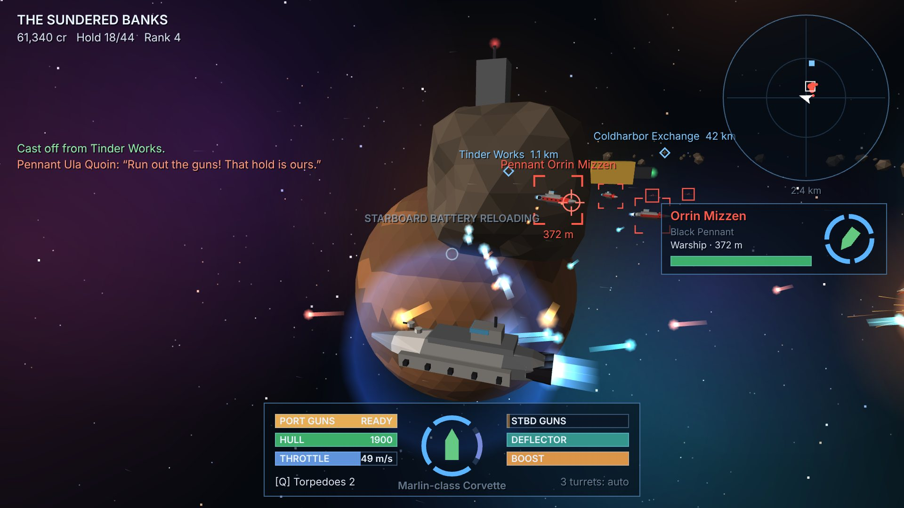

# IRONWAKE

**Run out the guns. Bring her about. Fire as you bear.**

An original capital-ship combat game on pure web standards: native ES modules,
one WebGL canvas, synthesized audio, no build step, no server, no account and
no network requests after load. Built on the
[VANILLAJS](https://github.com/QSOLKCB/VANILLAJS) engine.



## The game

You command a warship in the **Sundered Banks**, starting at Anchorage Prime
with the cutter *Tern*: three guns a side, two turrets and 4,000 credits.

- **Sail.** Every hull keeps to one battle plane. Throttle and rudder move a
  heavy ship that takes time to answer; the camera looks freely around her.
- **Broadsides.** Look to port or starboard to choose a battery, hold the
  trigger to steady the guns while the fan narrows, and release to fire every
  gun in a ripple. Lead a moving ship by aiming at the red marker.
- **Turrets and torpedoes.** Turrets pick their own targets and keep the
  strike craft off you. Torpedoes home on the ship you have selected.
- **Screens and deflector.** Four shield screens cover bow, stern and each
  beam: when one is down, turn another toward the enemy. The deflector soaks
  most of a salvo for a few seconds, then has to recharge.
- **Trade and mine.** Five ports buy and sell eight goods, and a market board
  posts each day's shortages and gluts. Small rocks crack under a broadside
  into ore and crystal; cargo is tractored aboard automatically.
- **Contracts.** Bounties on corsair squadrons, convoys calling for help,
  bonded freight, and the Harbor Watch's four **Most Wanted** captains.
- **Grow.** Four hulls from cutter to dreadnought, four broadside batteries,
  four turret types, and shield, deflector, drive and armour fittings.

Lose your ship and you return to your last port as it was when you docked.
The game saves in this browser each time you dock.

## Controls

| Input | Action |
| --- | --- |
| Mouse | Look around the ship (click the view to capture the pointer; dragging also works) |
| Arrow keys | Look around without the mouse |
| W / S | Throttle up / down |
| A / D | Rudder to port / starboard |
| Shift (hold) | Boost |
| Left mouse or Space (hold, then release) | Steady and fire the broadside you are looking along |
| E (hold) | Deflector |
| Q | Torpedo at the selected ship |
| Right mouse | Select the enemy under the cursor (centre crosshair while captured) |
| R / T | Nearest hostile / next ship |
| N | Plot a course to the next port or contract marker |
| J | Warp drive toward the plotted course |
| F | Dock when close and below 80 m/s |
| M | Sector chart (click a port to plot a course) |
| Wheel | Camera distance |
| Esc, P | Pause |

Built for a mouse and keyboard on a desktop browser with WebGL.

## Run it

Browsers do not load ES modules from `file://`, so serve the repository over
HTTP. From the repository root:

```bash
npm start
```

Then open the printed address and choose IRONWAKE.

## How it is built

| Part | Role |
| --- | --- |
| `js/sim/` | The whole game as a deterministic, DOM-free simulation |
| `js/render.js` | Scene drawing on the engine's `render-webgl` module |
| `js/hud.js`, `js/ui.js` | Bridge display, radar and chart (2D canvas); port screens (DOM) |
| `js/audio.js` | Effects scored as engine `audio2d` events and baked once; a generative score |
| `js/app.js` | Input, the fixed 60 Hz loop, orbit camera and screens |
| `vendor/vanillajs/` | Eleven unmodified engine modules with licence and provenance |

Hulls move through the engine's `flight` module, constrained to the plane.
Each broadside is an engine `weapons` timer that ripples its magazine and
reloads. Every shell is swept against one per-tick `adaptive-circles` snapshot
of the hulls and a static one of rocks and stations. Turrets find targets
with `range2d` and aim with `lead-solver`. The camera uses the engine's
pointer-lock mouse look. See [`NOTICE.md`](NOTICE.md).

## Verify

```bash
npm test
```

runs every game's tests with nothing to install. With Playwright and Chromium
available, `npm run test:browser` also plays the games in a real browser.

## Originality

IRONWAKE is an original game in its genre. See [`NOTICE.md`](NOTICE.md) for
what it does and does not contain.
