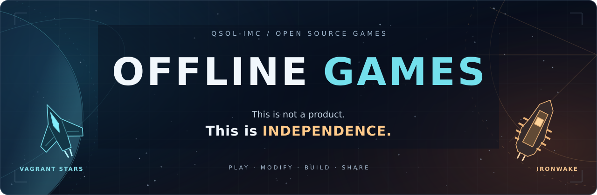
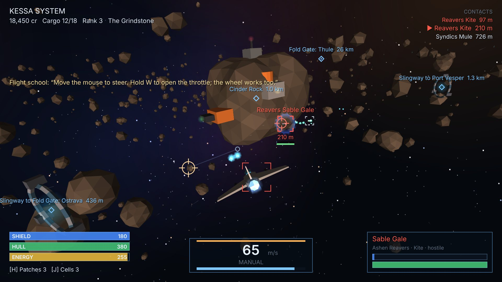
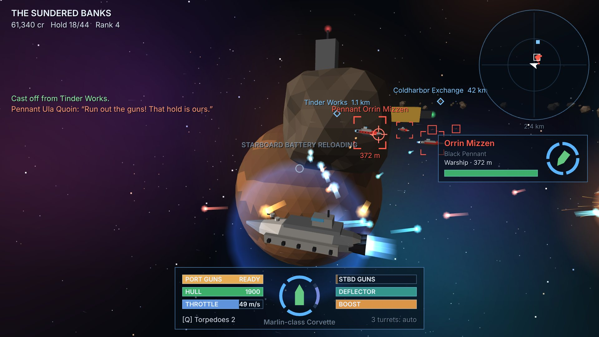

<p align="center">
  
</p>

<p align="center">
  <a href="https://github.com/QSOLKCB/OFFLINE-GAMES/actions/workflows/pages.yml"></a>
  <a href="https://github.com/QSOLKCB/OFFLINE-GAMES/releases/latest"></a>
  <a href="LICENSE"></a>
  <a href="https://qsolkcb.github.io/OFFLINE-GAMES/"></a>
</p>
<p align="center">
  <a href="#run-locally"></a>
  <a href="#take-the-controls"></a>
  <a href="MOD_GUIDE.md"></a>
  <a href="https://github.com/QSOLKCB/VANILLAJS"></a>
</p>

<p align="center">
  <strong>Fly the frontier. Command the broadside. Build what comes next.</strong><br>
  Two original space games on pure web standards, with local source, controller support and editable mod packs.
</p>
<p align="center">
  <a href="https://qsolkcb.github.io/OFFLINE-GAMES/"><strong>PLAY THE GAMES</strong></a> &nbsp;·&nbsp;
  <a href="MOD_GUIDE.md"><strong>MAKE A MOD</strong></a> &nbsp;·&nbsp;
  <a href="HOW_TO_MAKE_OFFLINE_GAMES.md"><strong>BUILD YOUR OWN</strong></a> &nbsp;·&nbsp;
  <a href="https://github.com/QSOLKCB/OFFLINE-GAMES/releases/latest"><strong>GET THE RELEASE</strong></a>
</p>

---

## Choose your frontier

| [VAGRANT STARS](https://qsolkcb.github.io/OFFLINE-GAMES/VAGRANT_STARS/) | [IRONWAKE](https://qsolkcb.github.io/OFFLINE-GAMES/IRONWAKE/) |
| :--- | :--- |
| [](https://qsolkcb.github.io/OFFLINE-GAMES/VAGRANT_STARS/) | [](https://qsolkcb.github.io/OFFLINE-GAMES/IRONWAKE/) |
| **A fighter, a cargo hold, six star systems.** Freelancer-inspired flight through the Tessel Reach: trade, upgrade, take contracts and follow the Quiet Signal storyline. | **A warship, a broadside, a captain's judgement.** Rebel Galaxy-inspired combat across the Sundered Banks: trade, mine, raise the deflector and hunt the Most Wanted. |
| Scout patrols lead to freighter rescues and ace encounters. Follow marked signals, collect salvage and return to port for the next refit. | Break a pirate picket, defend a relief ship, then face Captain Redwake. Turn a fresh shield toward incoming fire and make every salvo count. |
| [Play VAGRANT STARS](https://qsolkcb.github.io/OFFLINE-GAMES/VAGRANT_STARS/) · [Game guide](VAGRANT_STARS/README.md) · [Patrols & controls](docs/VAGRANT-FREE-ROAM.md) | [Play IRONWAKE](https://qsolkcb.github.io/OFFLINE-GAMES/IRONWAKE/) · [Game guide](IRONWAKE/README.md) · [Patrols & controls](docs/IRONWAKE-FREE-ROAM.md) |

Both games include procedural nebula skies, textured planets and atmospheres, animated port approaches, live dockside views and layered stereo sound. Each lives in its own folder with its own tests and a pinned copy of the [VANILLAJS](https://github.com/QSOLKCB/VANILLAJS) modules it uses.

## Visuals, CPU play and the new story

Both games start with Canvas software rendering: no WebGL, WebGPU or WASM is required to play. Nearby hulls gain inset armor panels and edge lighting; stations gain surface panels and illuminated windows. Planets use cached procedural surfaces, storms and atmospheric rims. GALAXY supplies the deterministic decorative star field; VANILLAJS still drives the games.

When a compatible non-fallback WebGPU adapter and WASM support are available, the title screen offers **Enable WebGPU + WASM**. It stays off until clicked, does not persist across reloads, and returns to CPU rendering on device loss or initialization failure. **Use CPU** switches back. The former renderer remains available with `?renderer=webgl` for comparison. Graphics never change collision geometry, hardpoints, flight, combat, or mission simulation.

IRONWAKE also offers **Story campaign · The Lantern Ledger**, an original eight-chapter journey through freight, convoy rescue, trading, mining, refitting and broadside battles. Story captains have a separate save from the original free captain mode. Read the wardroom log for your next contact and visit their port's Contracts board. Failed or abandoned story contracts can be retried; free sailing and the Most Wanted hunt remain available after the ending.

Local measurements and compatibility limits are recorded in [visual overhaul notes](docs/VISUAL-OVERHAUL.md). New screenshots and raw measurements can be regenerated with `npm run test:overhaul` and `npm run test:assets` after installing Playwright. `TEST_HARDWARE_GPU=1 npm run test:overhaul` uses a visible browser and the system GPU when available.

## Built to be yours

- **Play locally.** No accounts, trackers or runtime cloud services. Serve a downloaded copy on your own machine, or use the hosted version's offline cache after its initial installation completes.
- **Keep the source.** The rules, models, sound scores, UI and vendored engine modules are included. Read them, change them, and distribute your work under the applicable licences.
- **Change the game.** Add missions, write new objective logic, create modes, extend equipment and replace ship geometry or procedural sounds.
- **Keep your campaigns separate.** Each mod pack version and mode has its own save profile. Original campaign saves stay separate; progress is saved at ports.

## Make it yours: Mods & modes

Open **Mods & modes** from either title screen. The included **Independence Kit** is a working example you can play, inspect and copy:

| In the kit | What it demonstrates |
| --- | --- |
| **Liberty hull** | Custom ship stats and geometry, with inherited weapon and engine hardpoints |
| **Independent cartographers** | A custom survey mission: hold position at a beacon to complete the scan |
| **Open hardware delivery** | A repeatable freight contract using the native cargo and docking rules |
| **Independent explorer** | Quiet exploration with ambient traffic disabled and board contracts available |
| **Three-wave proving ground** | Combat waves, repairs between rounds and a persistent completion prize |
| **Custom docking sound** | A replacement effect scored with VANILLAJS audio2d |

Packs are local JavaScript registered in each game's `mods/registry.js`. The API supports native contracts, custom mission handlers, mode hooks, live data tables, geometry factories, sounds and bounded save state. The supplied Python converter imports **triangulated OBJ positions** for ship meshes. Deeper changes to physics, rendering, input and UI remain available through the source.

| Guide | Start here if you want to… |
| --- | --- |
| [**MOD_GUIDE.md**](MOD_GUIDE.md) | Install a pack, create missions and modes, import meshes, replace sounds or understand save compatibility |
| [**HOW_TO_MAKE_OFFLINE_GAMES.md**](HOW_TO_MAKE_OFFLINE_GAMES.md) | Build a complete game, separate simulation from presentation, test it and distribute it without a runtime service |

## Take the controls

Both games support **mouse and keyboard** and controllers using the browser's **standard Gamepad API mapping**. Controller navigation covers flight, combat, maps, stations and the mod menu, with neutral-input arming and pause on an active controller's disconnection.

- **Right mouse button:** select an enemy under the cursor. IRONWAKE uses the centre of the view while pointer lock is active.
- **Q:** fire a missile in VAGRANT STARS or a torpedo in IRONWAKE.
- **E in IRONWAKE:** raise the deflector.
- **In-game help:** the full keyboard, mouse and controller mappings for each game.

The [VAGRANT STARS notes](docs/VAGRANT-FREE-ROAM.md) cover docking and slingway selection; the [IRONWAKE notes](docs/IRONWAKE-FREE-ROAM.md) cover broadside controls, shipping signals and warp approaches. [Presentation notes](docs/PRESENTATION.md) document the visual/audio work, VANILLAJS provenance and the OPT methods used in the game-side implementation.

## Run locally

Serve the repository root with Python's standard-library file server:

```bash
uv run --no-project python -m http.server 8080 --bind 127.0.0.1
```

Open **http://127.0.0.1:8080/**. If Python is already installed, `python3 -m http.server 8080 --bind 127.0.0.1` works too. Alternatively, use the included zero-dependency Node server:

```bash
node scripts/serve.mjs
```

No package installation is needed to play. The games use ES modules, so serve them over HTTP rather than opening `index.html` through `file://`. A local copy can be played without internet access. The hosted site registers a service worker on HTTPS; let the first cache installation finish before going offline.

## Tests, CI and reproducible builds

The [Publish offline games workflow](https://github.com/QSOLKCB/OFFLINE-GAMES/actions/workflows/pages.yml) tests both simulations, controller behaviour, mod lifecycles, save isolation, assets and the published file inventory. It also runs six Chromium browser scripts against gameplay, presentation and mod/offline workflows before staging the site. The badge above tracks **main-branch push runs**, including deployment.

Run the simulation and site suite with Node 20+ and Python 3 available:

```bash
node --test VAGRANT_STARS/tests/*.test.js IRONWAKE/tests/*.test.js tests/*.test.js
```

<details>
<summary><strong>Browser checks and evidence</strong></summary>

CI installs pinned Playwright/Chromium tooling for verification; it is not a game runtime dependency. With that tooling available locally, run:

```bash
node VAGRANT_STARS/tests/browser-smoke.mjs
node VAGRANT_STARS/tests/controller-browser.mjs
node IRONWAKE/tests/browser-smoke.mjs
node IRONWAKE/tests/controller-browser.mjs
node tests/presentation-browser.mjs
node tests/mods-browser.mjs
```

The mod suite exercises the actual workshop, synthetic controller input, custom mission completion, arena progression, isolated saves and cached offline reloads. Presentation checks exercise WebGL and Web Audio. CI preserves browser evidence as a workflow artifact. Synthetic controller checks complement testing with a physical controller.

</details>

Stage a complete static distribution:

```bash
node scripts/site.mjs sync-sw
node scripts/site.mjs build _site my-release
```

`_site/` contains the playable collection, engine modules, local mod packs and both creation guides. The build stamps the service worker with the supplied version. Use a distinct version for each distributed update.

## Deploy to GitHub Pages

The collection is published as **one site**: the launcher at the root, with each game in its own folder.

1. In repository **Settings → Pages**, choose **GitHub Actions** as the deployment source.
2. Merge into `main`, or run **Publish offline games** from the Actions tab.
3. Tests and staging must pass before deployment.

Pull requests verify and stage the site without deploying it. You can also host `_site/` on another static server or serve it locally. The repository root supports Pages' **Deploy from a branch** mode too, but that route bypasses this workflow's test gate.

## Find your way around

| Path | Purpose |
| --- | --- |
| `VAGRANT_STARS/`, `IRONWAKE/` | Game source, tests and vendored engine modules |
| `shared/` | CPU/WebGPU adapters, cached surface detail, optional WASM and GALAXY sources |
| `GAME/mods/registry.js` | Installed local mod packs for that game |
| `GAME/mods/independence-kit/` | Playable examples of missions, modes, models and sound |
| `GAME/js/sim/` | World rules, NPC behaviour, missions, captain state and geometry |
| `index.html`, `styles.css`, `assets/` | The collection page and its visual assets |
| `sw.js`, `manifest.webmanifest` | Cached offline access and installation metadata |
| `scripts/site.mjs`, `scripts/serve.mjs` | Distribution inventory, staging and local server |
| `scripts/obj-to-mod.py` | Dependency-free triangulated OBJ conversion |
| `tests/`, `.github/workflows/pages.yml` | Collection-level checks and CI/deployment |
| `docs/` | Gameplay, presentation and provenance notes; README artwork |

To add another game, create a folder with its entry page, styles, source, mods, notices and engine modules. Register it in `GAMES` inside `scripts/site.mjs`, add a Play card to `index.html`, and include its tests in the workflow. After adding or removing published files, run `node scripts/site.mjs sync-sw`.

## The foundations

[**VANILLAJS**](https://github.com/QSOLKCB/VANILLAJS) supplies the engine modules. [**INDEPENDENCE**](https://github.com/QSOLKCB/INDEPENDENCE) explains the principles behind software you can own, inspect and run. Engine digests and notices remain alongside each vendored copy; game-side optimization provenance is recorded in [docs/PRESENTATION.md](docs/PRESENTATION.md).

Game code is **Apache-2.0**. See [LICENSE](LICENSE), [NOTICE](NOTICE), and the notices shipped with the vendored modules and individual assets.

---

<p align="center">
  <strong>This is not a product. This is INDEPENDENCE.</strong><br>
  <a href="https://qsolkcb.github.io/OFFLINE-GAMES/">Play</a> ·
  <a href="MOD_GUIDE.md">Modify</a> ·
  <a href="HOW_TO_MAKE_OFFLINE_GAMES.md">Build</a> ·
  <a href="https://github.com/QSOLKCB/INDEPENDENCE">Declare Independence</a>
</p>
