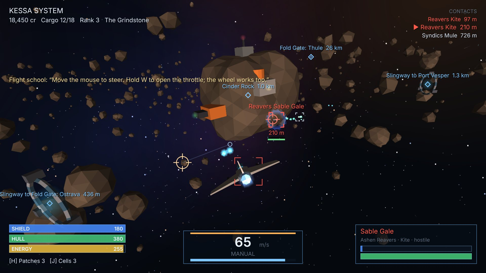

# VAGRANT STARS

**One ship. Six suns. Whatever you can carry, and whoever you can outfly.**

An original 3D space trading and combat game on pure web standards: native ES
modules, one WebGL canvas, synthesized audio, no build step, no server, no
account and no network requests after load. Built on the
[VANILLAJS](https://github.com/QSOLKCB/VANILLAJS) engine.



## The game

You are a free captain in the **Tessel Reach**, six star systems joined by fold
gates. You start at Calder Orbital Dock with a Sparrow, two pulse lasers and
2,500 credits.

- **Fly.** The ship turns toward the cursor. Throttle, strafe, afterburner, a
  cruise drive for long hauls, and engine-kill drifting. Slingway rings fling
  you across a system; fold gates jump between systems.
- **Fight.** Guns converge on the cursor, with a lead marker for the selected
  ship. Shields, hull, energy, homing missiles, hull patches and shield cells.
- **Trade.** Thirteen ports buy and sell twelve goods. Each port makes some
  things cheaply and pays well for others; contraband pays best and Warden
  patrols will impound it.
- **Work.** Contract boards offer bounties and courier runs. A five-part
  storyline, *A Quiet Signal*, starts at Tollard Station.
- **Standing.** Six factions remember who you shot. Fall far enough and their
  patrols open fire and their ports close.
- **Grow.** Six hulls from the Sparrow to the Wraith, ten guns, five shield
  generators and two missile racks, sold at different ports.

Lose your ship and you return to your last port as it was when you docked. The
game saves in this browser each time you dock.

## Controls

| Input | Action |
| --- | --- |
| Mouse | Steer toward the cursor |
| W / S, wheel | Throttle up / down |
| A / D | Strafe |
| X | Brake |
| Shift (hold) | Afterburner |
| C | Cruise drive (no guns while cruising) |
| Z | Cut engines and drift |
| Space | Free the cursor (arrow keys also steer) |
| Left mouse | Fire guns at the cursor |
| Q | Launch missile at the selected ship |
| Right mouse | Select the enemy under the cursor |
| R / T | Nearest hostile / next ship |
| Y | Select what the cursor is on |
| N | Next place |
| F | Dock, jump or ride (flies you there first) |
| G | Autopilot to the selection |
| B | Tractor in floating cargo |
| H / J | Hull patch / shield cell |
| M | Navigation map (click a place to select it) |
| Esc, P | Pause |

The game is built for a mouse and keyboard on a desktop browser with WebGL.

## Run it

Browsers do not load ES modules from `file://`, so serve the repository over
HTTP. From the repository root:

```bash
npm start
```

Then open the printed address and choose VAGRANT STARS. Any static server works.

## How it is built

| Part | Role |
| --- | --- |
| `js/sim/` | The whole game as a deterministic, DOM-free simulation: data, captain and economy, contracts, NPC pilots, and the live star system |
| `js/render.js` | Scene drawing on the engine's `render-webgl` module |
| `js/hud.js`, `js/ui.js` | Flight HUD and map (2D canvas), station screens (DOM) |
| `js/audio.js` | Effects scored as engine `audio2d` events and baked once; a generative score keyed to each system |
| `js/app.js` | Input, the fixed 60 Hz loop, camera and screens |
| `vendor/vanillajs/` | Ten unmodified engine modules with licence and provenance |

Every ship, the player's included, flies through the engine's `flight` module;
gunfire is the engine's `projectiles` system swept against moving ship boxes;
NPC gunnery and the HUD lead marker use `lead-solver`; docking permissions are
`interactions` rules. See [`NOTICE.md`](NOTICE.md).

## Verify

```bash
npm test
```

runs the simulation, data, save and site tests with nothing to install. With
Playwright and Chromium available, `npm run test:browser` also plays the game
through its interface in a real browser.

## Originality

VAGRANT STARS is an original game in the space trading and combat genre. See
[`NOTICE.md`](NOTICE.md) for what it does and does not contain.
